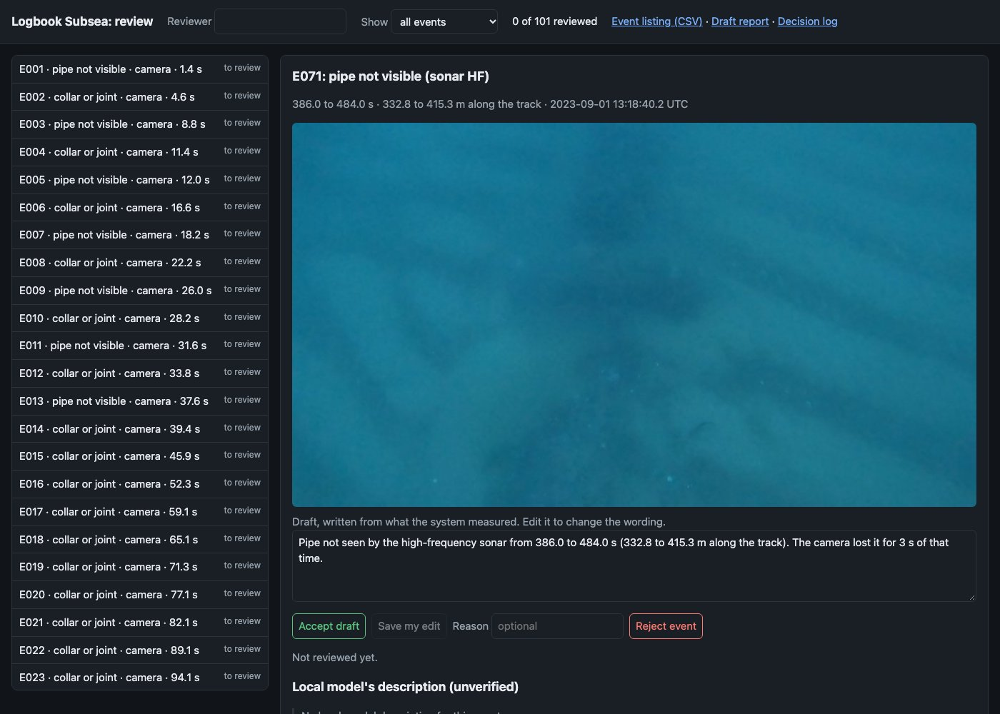

# Logbook Subsea (working title)

Turns underwater pipeline inspection data (camera video, side-scan sonar and navigation) into an event listing and a
draft inspection report, with a person approving every item.

> Independent demonstration project, built on public data. It is not for real
> integrity decisions: a qualified person decides, and a licensed engineer signs any engineering conclusion.

## Why
- **Review is slow.** Inspection teams watch hours of survey footage (one vendor claims 40 to 80 hours per survey) and
  log every finding against time and position.
- **Reports are assembled by hand:** an event listing, an anomaly report and a final report, which a qualified person
  checks and signs.
- **What this project does:** it automates the tedious parts and keeps the person in control. This matches how
  offshore regulators and DNV expect AI to be used.

## What it does
1. **Reads** camera frames, sonar images and navigation from the SubPipe dataset.
2. **Finds the pipe** in camera frames (segmentation) and in sonar images (detection).
3. **Turns per-frame results into events along the route.** Each event (exposed, covered by sand, not visible) gets a
   time, a position and a distance along the pipe, and all of them are shown on a map.
4. **Drafts a short description** of each event with a vision-language model running locally.
5. **Lets a person review** each item on a screen: accept, edit or reject. Every suggestion and decision is logged
   with the model version.
6. **Exports** the event listing and a draft anomaly report.
7. **Measures** everything, using the table below.

## Run it
```bash
python3.12 -m venv .venv && .venv/bin/pip install -r requirements.txt
scripts/download_subpipe.sh SubPipeMini.zip && unzip -q data/raw/SubPipeMini.zip -d data/
.venv/bin/python -I scripts/train_segmentation.py     # M1: pipe in camera frames (about 15 min)
.venv/bin/python -I scripts/train_sonar_detection.py  # M2: pipe in sonar (about 10 min)
.venv/bin/python -I scripts/build_events.py           # M3: event listing and map
.venv/bin/python -I scripts/describe_events.py        # M4: draft descriptions (downloads a 5.8 GB model once)
.venv/bin/uvicorn app.main:create_app --factory --host 127.0.0.1 --port 8000  # M5: open http://127.0.0.1:8000
.venv/bin/python -m pytest -q                         # tests
python3 scripts/quality_gate.py                       # checks the committed results against the requirements
.venv/bin/python -I scripts/evaluate_chunks.py        # unseen surveys, after fetch_chunks.py (see docs/EVALUATION.md, M6)
.venv/bin/python -I scripts/train_sonar_multichunk.py # sonar trained on three surveys, tested on two others (docs/EVALUATION.md, M6)
FROM_SCRATCH=1 .venv/bin/python -I scripts/train_segmentation.py  # without ImageNet starting weights (docs/LICENCES.md)
.venv/bin/python -I scripts/make_video.py             # the two-minute video, from the committed results
docker build -t logbook-subsea . && docker run --rm -p 127.0.0.1:8000:8000 logbook-subsea  # review screen in a container
```

GitHub runs the quality gate, the tests and the container build on every push ([.github/workflows/ci.yml](.github/workflows/ci.yml)).

**Documents:**
- [Data card](docs/DATA.md)
- [Evaluation](docs/EVALUATION.md)
- [Assurance note](docs/ASSURANCE.md)
- [Marking events by hand](docs/LABELLING.md)
- [Rating the drafts](docs/M4_REVIEW.md)
- [Video narration](docs/VIDEO_SCRIPT.md)
- [Licences](docs/LICENCES.md)


*The review screen: each event with its camera frame, a draft written from what the system measured, and accept, edit
or reject. Decisions go to an append-only log in `runs/review.sqlite`, outside git.*

## Requirements and how they are measured
The targets are starting points to revise after the first baseline. Every measured number will come from a recorded,
reproducible run.

| ID | Requirement | Proposed target | Measured |
|---|---|---|---|
| FR-01 | Load camera, sonar and navigation data for a survey chunk | Reproducible from `scripts/download_subpipe.sh` | Met: chunk 2 loaded and described in [docs/DATA.md](docs/DATA.md) |
| NFR-01 | Pipe segmentation in camera frames: mean IoU on held-out chunks | 0.80 | 0.841 on two held-out minutes of chunk 2 (pipe alone 0.737). Can't be scored on other chunks: the dataset has no camera labels outside chunk 2. Provisional on unseen chunks 3 and 4: mean IoU 0.795 (pipe 0.672) on 19 frames against reference outlines made with Segment Anything and checked by Claude; a frame check also finds 43 false alarms in 383 pipe-free frames. [docs/EVALUATION.md](docs/EVALUATION.md) |
| NFR-02 | Pipe in sonar, per window: balanced accuracy of "pipe" or "no pipe", and mAP@0.5–0.95, each above a box that never moves (changed 2026-11-23, see Decisions) | Balanced accuracy 0.90 | Met on unseen surveys after training on three: 0.95 (high frequency) and 0.96 (low frequency) on chunks 3 and 4, against 0.86 and 0.81 for the chunk-2-only model (0.903 and 0.932 when trained without COCO or ImageNet weights); a box that never moves scores mAP 0.06 to 0.07 there. The chunk-2-only model scores 0.80 and 0.39 on chunk 2's test minutes. [docs/EVALUATION.md](docs/EVALUATION.md) |
| NFR-03 | Event recall on a hand-labelled stretch of pipe | 90% | Provisional 0.917 (11 of 12 events), against marks made by Claude, not a person; to be re-marked per [docs/LABELLING.md](docs/LABELLING.md). Accepted by Mostafa as the project's result for now (2026-11-24); not an independent check. |
| NFR-04 | Draft descriptions rated correct by two reviewers | 80% | Not met, provisional: one reviewer (Claude) rates 45% of plain drafts and 50% of outlined drafts correct; nearly every collar draft misses the visible pipe. Two human reviewers still needed ([docs/M4_REVIEW.md](docs/M4_REVIEW.md)). Accepted by Mostafa as the project's result for now (2026-11-24); not an independent check. |
| NFR-05 | Share of drafts the reviewer edits or rejects | Reported, no target | Provisional 21% (3 of 14 edited, none rejected) from a demonstration review of 360–420 s by Claude; sample output in [docs/results/m5_demo_report.md](docs/results/m5_demo_report.md). Real reviewers still needed. Accepted by Mostafa as the project's result for now (2026-11-24); not an independent check. |
| NFR-06 | Processing time on an Apple M3 Pro, per hour of footage | Under 1 hour | Met: 9.6 minutes for the event pipeline (camera at 5 frames a second, both sonar bands), not counting training; descriptions add about 5 s per event ([m3_events.json](docs/results/m3_events.json)) |
| NFR-07 | Cost per survey with the local model | $0 | Met so far: every model in M1–M4 runs on the Mac, with no API calls |
| NFR-08 | AI suggestions and human decisions logged | 100% | Met by design and tested: a decision can only be saved through the call that logs it, append-only, with the suggestion and model versions ([tests/test_review_app.py](tests/test_review_app.py)) |

## Skills it demonstrates
| Skill | Where |
|---|---|
| Underwater imagery (turbidity, low contrast, colour loss) | M1 |
| Side-scan sonar | M2 |
| Geospatial data and logging events by position | M3 |
| Vision-language drafting | M4 |
| Human approval and decision logs | M5 |
| Industry deliverables (event listing, anomaly report) | M3, M5 |
| Evaluation and an assurance note in the style of DNV-RP-0671 | M6 |
| Production packaging: container, CI quality gate, monitoring | M6 |

## Plan (part-time, about six weeks)
| Milestone | Done when |
|---|---|
| M0 Data and data card | **Done 2026-11-23:** [docs/DATA.md](docs/DATA.md). The first mini archive turned out to contain camera, sonar and navigation data, so the second isn't needed yet |
| M1 Pipe in camera frames | **Done 2026-11-23:** mean IoU 0.841 on two held-out minutes (pipe alone 0.737), in [docs/EVALUATION.md](docs/EVALUATION.md) |
| M2 Pipe in sonar | **Done 2026-11-23:** mAP@0.5 0.839 (high frequency) and 0.713 (low frequency) on held-out minutes, short of 0.85, in [docs/EVALUATION.md](docs/EVALUATION.md) |
| M3 Events along the route, with a map | **Done 2026-11-23, score provisional:** listing and map; event recall 0.917 against marks made by Claude, to be re-marked by a person ([docs/LABELLING.md](docs/LABELLING.md)) |
| M4 Draft descriptions | **Drafts done 2026-11-23:** 40 drafts (plain and pipe outlined), about 5 s each, $0, but the model misses the pipe in 17 of 18 collar drafts; rubric scores wait for two reviewers ([docs/M4_REVIEW.md](docs/M4_REVIEW.md)) |
| M5 Review screen, logs and exports | **Done 2026-11-23:** review screen, append-only decision log, CSV and draft-report exports, 4 tests (see "Run it"); no real reviews yet |
| M6 Evaluation, assurance note, container, CI, two-minute video | **Done 2026-11-23:** results table filled in, [assurance note](docs/ASSURANCE.md), container, CI with a quality gate, [two-minute video](docs/video/logbook_subsea_2min.mp4) ([narration](docs/VIDEO_SCRIPT.md)) |

## Stack (permissive licences only)
- **Machine learning:** Python 3.12 and PyTorch.
  - Segmentation: torchvision (BSD) DeepLabV3 for the M1 baseline; segmentation-models-pytorch (MIT) if a finer
    decoder is needed.
  - Detection: torchvision Faster R-CNN (BSD) for the M2 baseline; RT-DETR in Hugging Face Transformers
    (Apache-2.0) as an alternative.
  - Not Ultralytics YOLO: it is AGPL-3.0, which would force any product built on it to be open source.
- **Geospatial:** the survey has only local coordinates, so distances come from numpy and the map from matplotlib.
  pyproj and folium come in once real coordinates do.
- **Vision-language model:** Qwen3-VL-8B-Instruct (Apache-2.0), 4-bit, run locally with mlx-vlm (MIT). Optionally a
  hosted model with a spending cap, for comparison.
- **Application:** FastAPI and SQLite.

## Decisions
| Date | Decision | Why |
|---|---|---|
| 2026-11-24 | Published on GitHub at Mostafa's direction, as a clean copy without the development history and with no open-source licence yet | A licence can be added later; one can't be withdrawn once granted |
| 2026-11-23 | Descriptions come from a **free local vision-language model** on the Mac through MLX | No cost per image, images never leave the machine, works offline. Offshore clients guard their data and vessels have weak internet |
| 2026-11-23 | Possible later step: compare the same 100 events against a hosted model, through a dedicated API account with a spending limit | Turns "local versus hosted" into measured evidence |
| 2026-11-23 | NFR-02 changed from mAP@0.5 of 0.85 (measured 0.839 high frequency, 0.713 low frequency) to balanced "pipe or no pipe" accuracy of 0.90 plus mAP@0.5–0.95, both compared with a box that never moves | On this survey a box that never moves scores 0.661 and 0.754 on mAP@0.5, so that measure can't tell a detector from no detector. The new measure makes low frequency look worse, not better |
| 2026-11-23 | The 360–420 s minute was marked by Claude, at Mostafa's request, as a provisional stand-in | Claude built the event rules and had seen the output for that minute, so the NFR-03 score is not independent until a person re-marks it |
| 2026-11-23 | For new surveys, use the sonar model trained on chunks 0, 1 and 2; the chunk 2 event listing keeps the chunk-2-only model | The three-survey model meets NFR-02 on unseen chunks 3 and 4, but it has seen chunk 2's test minutes |
| 2026-11-24 | **Deliver the three-survey sonar model trained from scratch** (`models/m6_sonar_multichunk_scratch.pt`). Chosen by Claude at Mostafa's request; reverse it if you prefer the COCO version | It meets NFR-02 on unseen chunks 3 and 4 (0.903 high frequency, 0.932 low frequency) with no ImageNet or COCO weights, so there's no licence question. The COCO version is stronger (0.950, 0.956) but needs that question settled |
| 2026-11-23 | At Mostafa's request, Claude also stood in for the other human steps, all marked provisional: rating the 40 M4 drafts (one reviewer), a demonstration review of 360–420 s, and frame-by-frame camera labels on the unseen chunks | Every file and result says who made it. NFR-03, NFR-04, NFR-05 and the camera check count only once people redo them |

## Provisional checks to redo
**Status, 2026-11-24:** four steps meant for people were done by Claude as a stand-in, and Mostafa accepted the
results for now. They are Claude's work, not independent checks, and they are labelled that way everywhere. Redoing
them with people makes the results independent; it takes about 1.5 hours.

| # | Step | Time | How |
|---|---|---|---|
| 1 | Mark collars and pipe-not-visible stretches in 360–420 s | 30 min | [docs/LABELLING.md](docs/LABELLING.md). Delete the provisional rows first, keep the header |
| 2 | Two reviewers, separately, rate the 40 draft descriptions | 15 min each | [docs/M4_REVIEW.md](docs/M4_REVIEW.md); add rows under your own names in `labels/m4_ratings.csv` |
| 3 | Review events in the app; accept, edit or reject | 20 min | "Run it" above; then export the draft report |
| 4 | Check the 19 reference pipe outlines and fix any choice | 15 min | `docs/figures/m6_outline_candidates.jpg` and `labels/camera_outline_choice.csv` |

Then re-run `scripts/build_events.py`, `scripts/describe_events.py --ratings-only` and `python3 scripts/quality_gate.py`.

## Data
[SubPipe](https://zenodo.org/records/12666132), CC BY 4.0. Required credit:

> SubPipe is a public dataset of a submarine outfall pipeline, property of Oceanscan-MST. This dataset was acquired
> with a Light Autonomous Underwater Vehicle by Oceanscan-MST, within the scope of Challenge Camp 1 of the H2020 REMARO
> project.

| Archive | Size | Contents |
|---|---|---|
| `SubPipeMini.zip` | 6.08 GB (about 12 GB unzipped) | Camera images of the pipeline with segmentation labels |
| `SubPipeMini2.zip` | 4.95 GB (about 16 GB unzipped) | Side-scan sonar images with pipeline bounding boxes (COCO and YOLO) |
| `SubPipe.zip` | 28.01 GB (about 80 GB unzipped) | Everything; only if needed |

Data stays out of git. `scripts/download_subpipe.sh SubPipeMini.zip` downloads an archive and checks its MD5.

## Licence and use
- **No open-source licence yet.** The code is public to read, with all rights reserved; MIT or Apache-2.0 can be
  added later.
- Built only on public data: no partner or client data, and nothing under an NDA.
- Before any paid use, settle the terms of the pretrained weights. The M1 and M2 models start from torchvision's
  ImageNet- and COCO-trained weights, and ImageNet's terms cover non-commercial research only. Training without
  them was tested and costs little ([docs/EVALUATION.md](docs/EVALUATION.md), M6), so the simplest fix is to deliver
  from-scratch models. Details in [docs/LICENCES.md](docs/LICENCES.md).
