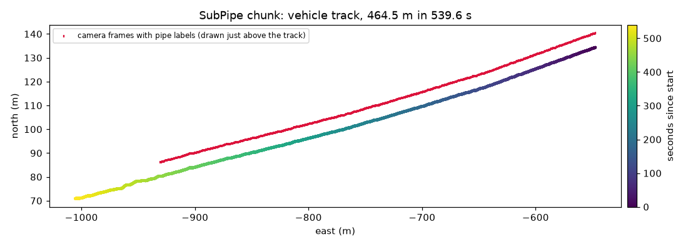
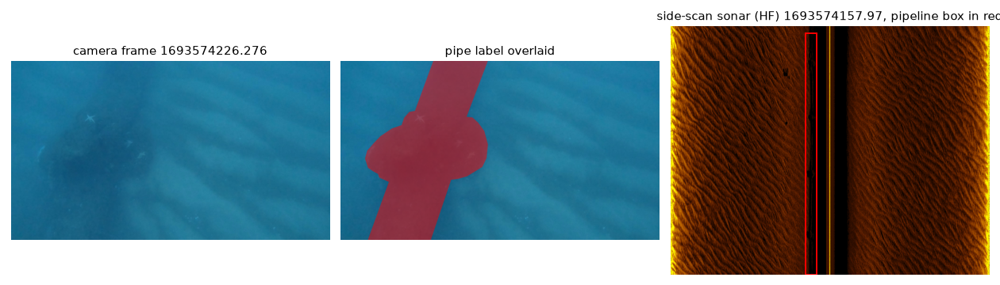
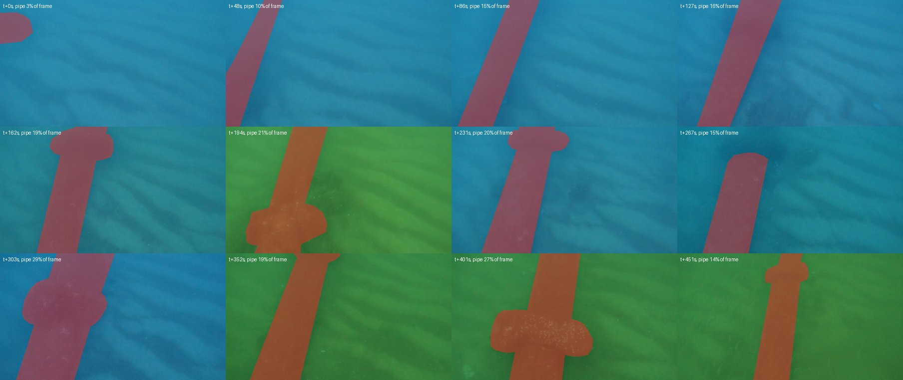

# Data: SubPipe, chunk 2 (the "SubPipeMini" archive)

Milestone M0. Every number below comes from `scripts/explore_data.py`, whose output is saved in
[`data_summary.json`](data_summary.json), except where a line says "M1 run" or "M2 run"
([`results/m1_segmentation.json`](results/m1_segmentation.json),
[`results/m2_sonar_detection.json`](results/m2_sonar_detection.json)).

## Source and credit
[SubPipe](https://zenodo.org/records/12666132), version 3.0.1, CC BY 4.0. Required credit:

> SubPipe is a public dataset of a submarine outfall pipeline, property of Oceanscan-MST. This dataset was acquired
> with a Light Autonomous Underwater Vehicle by Oceanscan-MST, within the scope of Challenge Camp 1 of the H2020 REMARO
> project.

The archive is `SubPipeMini.zip`: 6.08 GB download, 11 GB unpacked, 21,607 files. It is a subset of the full dataset
(its navigation logs refer to "Chunk2").

## What it contains
| Part | Contents |
|---|---|
| **Survey** | One pass by an autonomous underwater vehicle along an outfall pipeline partly covered by sand: 1 September 2023, from 13:12 UTC, 539.6 s long, a 464.5 m track at a median 0.86 m/s, 16.0–17.3 m deep, 2.6–3.4 m above the seabed |
| **Camera 0** (GoPro Hero 10) | 16,170 frames at 29.96 per second, 2704 × 1520 pixels; one navigation row per frame |
| **Camera 1** | 2,160 frames at 4.0 per second, 1936 × 1216 pixels; no labels |
| **Pipe labels** | 647 Camera 0 frames with a pipe/background mask. The pipe covers a median 17.1% of a labelled frame. Labels cover the first 451 s (M1 run) |
| **Side-scan sonar, high frequency** | 539 images (5000 × 500), one per second, each showing the last 25 s of pings; 435 have a "Pipeline" box, in COCO and YOLO formats |
| **Side-scan sonar, low frequency** | 539 images (2500 × 500), one per second, each showing the last 25 s of pings; 455 have a "Pipeline" box |
| **Navigation and sensor logs** | One row per Camera 0 frame. `EstimatedState.csv` holds position (x, y, z in metres on a local grid), roll, pitch, heading, velocities, depth and altitude. Also: acceleration, altitude from four sonar beams, angular velocity, depth, an echo sounder, pressure, propeller RPM, temperature, water velocity |







## Quirks found, and how the code handles them
1. **Mixed image formats.** 107 of the 647 labelled frames are saved as PNG rather than JPG, so the loader accepts
   both.
2. **Slightly different timestamps.** 87 labelled frames sit 0.004–0.017 s from the nearest Camera 0 frame (less than
   half a frame), and one Camera 0 frame has no navigation row with exactly the same time. Frames are matched by
   nearest time.
3. **Masks in three formats.** 523 are palette images (pipe = 1), 18 greyscale and 106 colour (pipe = 128, 0, 0).
   Any non-zero pixel counts as pipe.
4. **Sonar file extension.** The sonar images end in `.pbm` but open as colour images.
5. **Local coordinates only.** Positions are metres on a local grid, with no latitude or longitude. Distance along
   the route is computed from x and y, and the map is local.
6. **Sonar images overlap.** Each holds the last 500 pings, about 25 s. One second later the same picture has moved
   down 20 rows, with 20 new pings on top, so neighbouring images share 96% of their pixels. The M2 split keeps
   training images at least 25 s from test images (M2 run).

## What the data shows
- **The pipe is labelled in almost every frame, but often hard to see.** Contrast is low against rippled sand.
- **There are regular wider features along the pipe** (collars, joints or ballast blocks). They play the role of the
  "field joints" logged in real pipeline surveys, and can be found from the width of the pipe label without extra
  labelling.
- **The water colour switches between blue and green more than once.** Minute by minute it is mostly blue in 0–180 s
  and 240–300 s and mostly green in 180–240 s and from 300 s on, with shorter switches inside some minutes (M1 run).
  Any model has to cope with both, and the test covers both.
- **In places the label ends partway across the frame,** where the pipe is covered or leaves the view.
- **In the sonar, the pipe stays at almost the same range** (high-frequency box centre 2,191 ± 22 px of 5,000;
  low-frequency 1,092 ± 9 px of 2,500), because the vehicle follows it. A box that never moves would already score
  well, so M2 compares the detector against one (M2 run).
- **The pipe drops out of the sonar near the end.** Pipe boxes cover 7–423 s and 496–513 s in high frequency and
  14–469 s in low frequency, apart from one window at 95 s (M2 run). Over the last 100 s the vehicle rolls and
  pitches much more (navigation log), and the sonar images streak.

## The other chunks in the full archive (M6)
`SubPipe.zip` holds five chunks. [`scripts/fetch_chunks.py`](../scripts/fetch_chunks.py) reads parts of it from
Zenodo without the full 28 GB download.
- **Camera labels exist only in Chunk 2.** Chunks 0, 1, 3 and 4 have camera video and sonar labels, but no pipe masks.
- **The pipe sits at a different range in each chunk,** for example 73% across the sonar image in Chunk 0 (the other
  side of the vehicle) and 22% in Chunk 3, against 44% in Chunk 2
  ([`results/m6_held_out_chunks.json`](results/m6_held_out_chunks.json)). The vehicle often runs beside the pipe, out
  of the camera's view.
- **Archive quirks:**
  - 108 high-frequency images in Chunk 0 and 110 low-frequency images in Chunk 4 end in `.bpm` instead of `.pbm`.
  - Chunk 0's high-frequency labels include a stray file, `d.860.txt`.

  The M6 evaluation skips both and counts them.

## Event types this data supports
| Event | Found from | Ground truth |
|---|---|---|
| Pipe visible or not visible along the route | Camera masks, sonar boxes, navigation | From the labels |
| Collar or joint | Widening of the pipe mask | Derived from the labels, checked by hand on a sample |
| Sand cover, growth, debris (descriptions) | The vision-language model | None; two reviewers rate a sample |

## How we split it for honest testing
- **Split by time, not at random.** Frames 1/30 s apart are near-duplicates, so a random split would leak answers
  from training into testing.
- **Use contiguous blocks** of about one minute, keep each whole block in training, validation or test, and include
  both blue-water and green-water blocks in the test set. M1 does this; its blocks are listed in
  [EVALUATION.md](EVALUATION.md).
- **Limit:** this is one 9-minute pass over one pipeline, so results here can't show that the method works on other
  pipelines. The full archive (`SubPipe.zip`, 28 GB) has more chunks for a later check on unseen data.
- **The second archive** (`SubPipeMini2.zip`, sonar-focused, 4.95 GB) isn't needed yet. This chunk already has 1,078
  sonar images with labels.

## Reproduce
```bash
scripts/download_subpipe.sh SubPipeMini.zip
unzip -q data/raw/SubPipeMini.zip -d data/
.venv/bin/python -I scripts/explore_data.py > docs/data_summary.json
```
