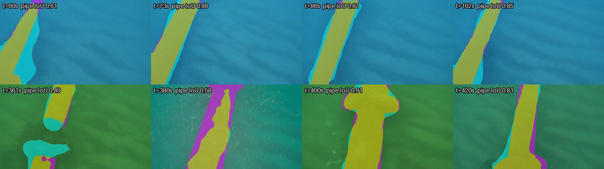
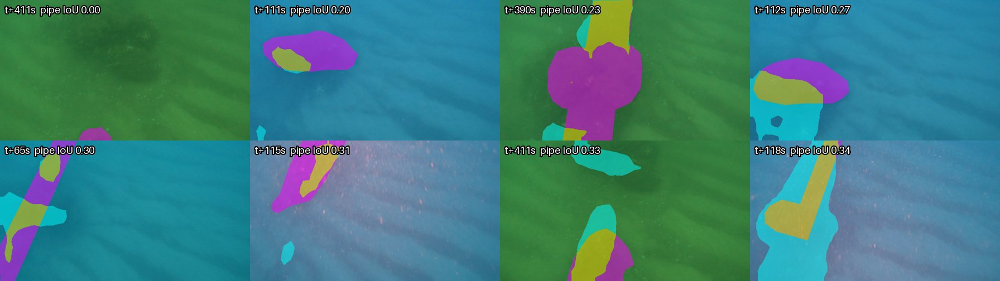
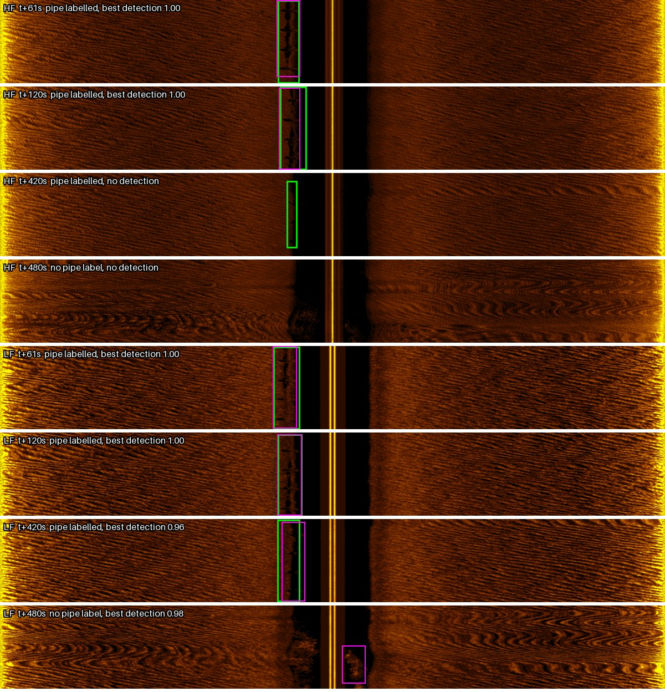
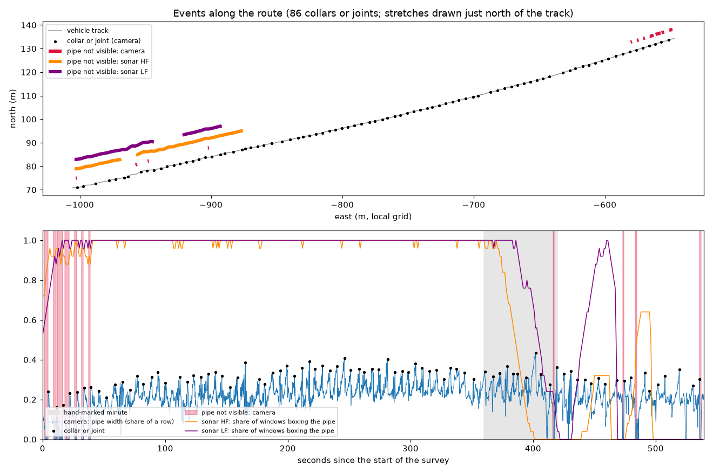
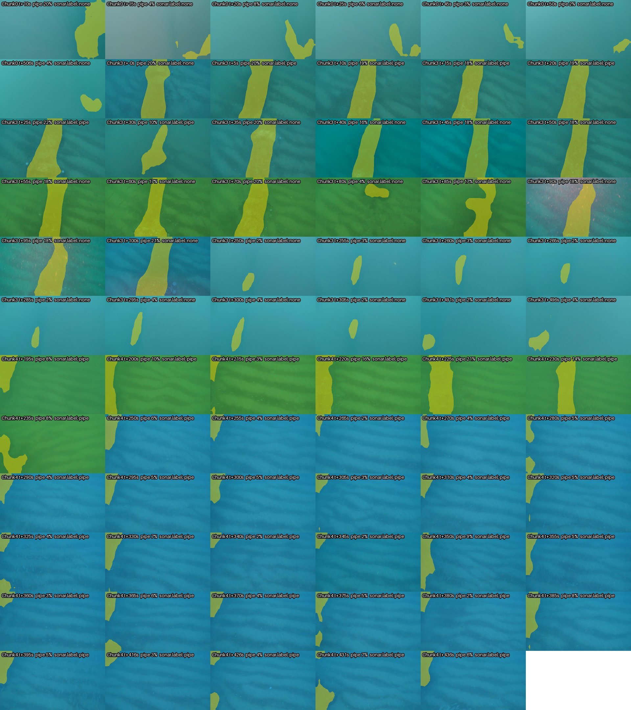
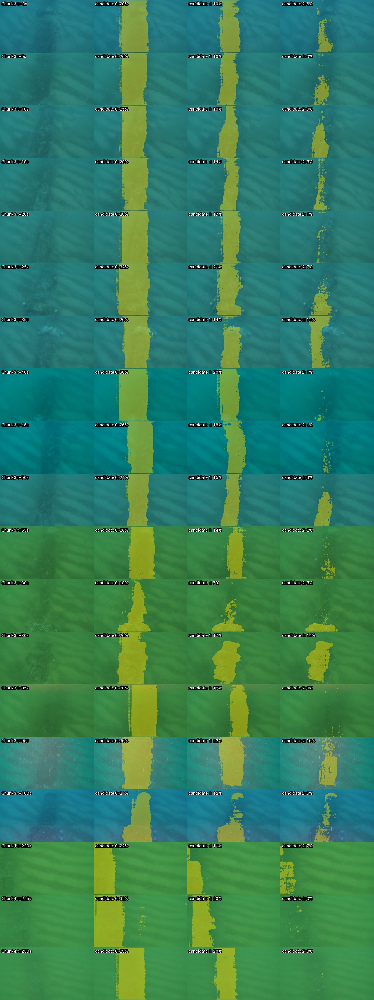

# Evaluation

Each milestone's numbers come from a script in `scripts/`, and the full output is saved in [`results/`](results/).

## M1: finding the pipe in camera frames

**Result:** mean IoU **0.841** on two held-out minutes of the survey, against a proposed target of 0.80. The pipe on
its own scores **0.737**. Other survey chunks are not tested yet.

### Setup
- **Task:** mark every pipe pixel in a camera frame.
- **Data:** the 647 labelled Camera 0 frames of SubPipe chunk 2 ([data card](DATA.md)), resized from 2704 × 1520 to
  640 × 360.
- **Split by time, not at random.** The 451 labelled seconds are cut into one-minute blocks, and each block goes
  wholly to training, validation or test. Training frames within 5 s of a validation or test frame are dropped,
  because the camera sees much the same seabed for a few seconds. The test minutes were chosen by water colour,
  before any training.

  | Seconds | Labelled frames | Water | Used for |
  |---|---|---|---|
  | 0–60 | 72 | Blue | Training |
  | 60–120 | 91 | Blue | **Test** |
  | 120–180 | 103 | Blue | Training |
  | 180–240 | 100 | Both, mostly green | Validation (picking the epoch) |
  | 240–300 | 98 | Blue | Training |
  | 300–360 | 74 | Both, mostly green | Training |
  | 360–420 | 72 | Green | **Test** |
  | 420–451 | 37 | Mostly green | Training |

  That leaves 344 training, 100 validation and 163 test frames. 40 frames were dropped for being too close to held-out
  ones.
- **Model:** DeepLabV3 with a MobileNetV3-Large encoder, from torchvision (BSD licence), small enough to run on a
  laptop. The encoder starts from ImageNet weights; the segmentation head starts from scratch.
- **Training:** 40 epochs, batch 8, AdamW with learning rate 0.0003 and cosine decay, binary cross-entropy, random
  horizontal flips and colour jitter, seed 0. The weights kept are from the epoch with the best validation score
  (epoch 15). The test frames were scored once, after training.
- **Scores:** *pipe IoU* is the number of pixels that both the model and the label call pipe, divided by the number
  that either calls pipe, counted over all test frames. *Mean IoU* averages pipe IoU and background IoU. It is the
  figure segmentation papers usually report, and the one NFR-01 uses.

### Results
| Test frames | Pipe IoU | Mean IoU |
|---|---|---|
| All 163 | 0.737 | **0.841** |
| 60–120 s, blue water (91) | 0.758 | 0.856 |
| 360–420 s, green water (72) | 0.716 | 0.825 |

- **Per frame,** pipe IoU has a median of 0.785. One frame in ten scores below 0.45, and 23 of the 163 score below
  0.5.
- **Training** took 14 minutes on an Apple M3 Pro.
- **Speed:** about 56 frames a second at 640 × 360 on the same Mac, counting the model only (frames already decoded).
  The camera records 30 a second.
- **Reproducible:** running the script twice gave identical scores.


*Eight test frames, spread evenly over the two test minutes. Yellow: pipe found. Magenta: pipe missed. Cyan: false
alarm.*


*The eight test frames with the lowest pipe IoU, in the same colours.*

### What it means
- **Where the pipe is plainly visible, the model finds it.** Most of the remaining error there is a thin band along
  the pipe's edges, which lowers IoU but doesn't change whether the pipe is found.
- **The failures are the cases an inspector cares about.** In the worst frames the pipe is mostly hidden, likely
  buried, and only a small or irregular patch is labelled (around 111 s and 411 s). Others show cloudy water full of
  particles (115 s and 118 s), a faint pipe on low-contrast sand (65 s) and a missed collar (390 s).
- **Green water may be harder.** Pipe IoU is 0.716 in the green minute against 0.758 in the blue one, from a single
  seed, so treat the gap as a lead rather than a finding. Only two of the five training minutes are mostly green, so
  more green-water data is the first thing to try.
- **The headline number flatters.** Mean IoU meets the proposed 0.80 because the background is easy. The pipe on its
  own scores 0.737.
- **For M3, single frames are too noisy to log events from.** "Pipe visible" and "pipe not visible" should be decided
  over a few seconds of frames.

### Limits
- **One survey of one pipeline.** Held-out minutes are not held-out surveys: the seabed, light and pipe match
  training. NFR-01 is stated for held-out chunks, which the full 28 GB archive can provide.
- **One seed.** How much the score moves with a different seed is not measured. Validation pipe IoU swung between
  0.63 and 0.76 from epoch to epoch after epoch 8, so differences of a few hundredths shouldn't be over-read.
- **Scored at 640 × 360,** not the camera's full resolution.
- **Labels are taken as truth.** Where the pipe is buried, the label is itself a judgement.

### Reproduce
```bash
.venv/bin/pip install -r requirements.txt
.venv/bin/python -I scripts/train_segmentation.py
```
It writes [`results/m1_segmentation.json`](results/m1_segmentation.json) and the two figures. Downloaded weights and
the trained model go to `models/`, which is outside git.

## M2: finding the pipe in sonar

**Result:** mAP@0.5 **0.839** in high frequency and **0.713** in low frequency on held-out minutes, short of the
proposed 0.85. That measure says little here: a box that never moves scores 0.661 and 0.754, because the vehicle
follows the pipe. What the detector adds is knowing when the pipe isn't there. In the clean stretches it finds the
pipe in every window, and nearly all its errors sit near the end of the survey.

### Setup
- **Task:** draw a box around the pipe in each sonar image, or none when the pipe isn't visible.
- **Data:** 539 high-frequency and 539 low-frequency sonar images ([data card](DATA.md)), scaled to 1,333 pixels
  across. Each is a rolling window over the last 25 s of pings, so neighbouring images share 96% of their pixels.
- **Split by time, with a 25 s gap.** Test: 60–120 s and 360–480 s, which are the M1 test minutes plus the minute
  where the pipe drops out of the sonar. Training: every window at least 25 s from a test window. Keeping M1's test
  minutes lets M3 test both sensors on stretches neither model has seen.

  | Band | Training windows (with pipe) | Test windows (with pipe) | Dropped in the gaps |
  |---|---|---|---|
  | High frequency | 263 (231) | 180 (123) | 96 |
  | Low frequency | 263 (215) | 180 (168) | 96 |
- **Model:** Faster R-CNN with a MobileNetV3-Large backbone from torchvision (BSD licence), starting from COCO-trained
  weights with a new pipe-or-background head. One model serves both bands.
- **Training:** 20 epochs, batch 4, SGD with a one-cycle learning rate peaking at 0.005, and random left-right
  mirroring so the model can't rely on which side the pipe is on; seed 0. The final weights are used. There is no
  validation set, which keeps more data for training.
- **Scores:**
  - *mAP@0.5* (NFR-02): average precision, counting a box as correct when its IoU with the labelled box is at least
    0.5.
  - *mAP@0.5–0.95:* the same, averaged over IoU thresholds from 0.5 to 0.95, which rewards tighter boxes.
  - *Pipe windows found* and *no-pipe windows left empty:* a window counts as "pipe seen" when its best detection
    scores 0.5 or more.
  - *Fixed box:* the median training box, drawn in every test window with full confidence. No learning at all.

### Results
| Band | Method | mAP@0.5 | mAP@0.5–0.95 | Pipe windows found | No-pipe windows left empty |
|---|---|---|---|---|---|
| High frequency | Detector | 0.839 | 0.520 | 98 of 123 | 46 of 57 |
| High frequency | Fixed box | 0.661 | 0.360 | 123 of 123 | 0 of 57 |
| Low frequency | Detector | 0.713 | 0.514 | 132 of 168 | 0 of 12 |
| Low frequency | Fixed box | 0.754 | 0.436 | 168 of 168 | 0 of 12 |

- **Training** took 8 minutes on the M3 Pro. The detector then handles about 46 sonar windows a second.
- **Not exactly reproducible:** an earlier run with the same settings scored 0.835 and 0.719, and found 138 rather
  than 132 low-frequency pipe windows. Training this model on the Mac's graphics chip isn't deterministic.


*Four test windows per band, spread over the test seconds. Green: labelled pipe. Magenta: the detector's best box. The
dark band in the middle is the water below the vehicle, which side-scan sonar can't image.*

### Where the errors are
Every test window's result is in [`results/m2_sonar_detection.json`](results/m2_sonar_detection.json), under
`test_windows`.
- **Clean stretches:** in 60–120 s and 360–380 s the detector misses nothing in either band (160 windows). Its one
  false alarm there is at 95 s in low frequency, where the labels skip one window although the windows either side,
  which share 96% of its pixels, show the pipe. That looks like a missing label.
- **Misses:** all are near the end, where the pipe fades from the sonar: 397–423 s in high frequency (the last
  labelled window the detector finds is at 401 s) and 412–453 s in low frequency. The camera model also struggled
  around 390–411 s, where the pipe looked mostly buried (M1).
- **Other false alarms:** all 22 are on the other side of the vehicle from the labelled pipe, at 464–480 s, in both
  bands. From 440 s the vehicle rolls, pitches and turns more (navigation log), and unlabelled camera frames from
  462–468 s appear to show the pipe crossing the frame diagonally. The vehicle may have drifted across the pipe,
  which would move it to the other side of the sonar, where the labels don't mark it. These count as false alarms
  above until someone checks.

### Label check (added in M6)
- **What the sonar shows:** rebuilding the sonar from 380 to 539 s at higher resolution shows strong returns right
  beside the vehicle on both sides, from about 435 to 470 s, in both bands. The camera shows the pipe at the same time.
  That fits the vehicle passing over the pipe. It isn't proof, so no labels were changed.
- **Effect on the score:** setting aside the windows that may be mislabelled changes balanced accuracy. Those are the
  unlabelled windows from 460 to 481 s (20 in high frequency, 11 in low frequency) and the low-frequency gap at 95 s.
  The filter on `test_windows` is exactly that.

  | Band | As labelled | Uncertain windows set aside |
  |---|---|---|
  | High frequency | 0.80 (46 of 57 no-pipe windows left empty) | 0.90 (37 of 37) |
  | Low frequency | 0.39 (0 of 12) | Can't be measured: no no-pipe windows remain |
- **What that means:** in high frequency, nearly every remaining error is a miss where the pipe fades (397–423 s). In
  low frequency, this test can't say how well the detector knows the pipe is absent. The unseen surveys in M6 can.

### What it means
- **On this survey, where the pipe is comes free; whether it's visible is the hard part.** The detector beats the
  fixed box by leaving no-pipe windows empty and by drawing tighter boxes, not on mAP@0.5.
- **NFR-02 changed on 2026-11-23** to balanced accuracy (the average of the share of pipe windows found and the share
  of no-pipe windows left empty) plus mAP@0.5–0.95, both against the fixed box, with a target of 0.90. From the counts
  above: high frequency 0.80 (fixed box 0.50), low frequency 0.39 (fixed box 0.50). Low frequency falls below the
  fixed box because it boxed something in all 12 of its no-pipe windows, 11 of which may hold unlabelled pipe.
- **The collars probably show in the sonar too,** as regular marks along the pipe (top two strips of the figure). That
  would give M3 a second way to log joints.
- **For M3:** a sonar window spans 25 s, so its box rows need mapping back to ping times. The camera has to cover what
  the sonar can't see directly below the vehicle.

### Limits
- **One survey of one pipeline.** Here the pipe stays at one range. On other surveys it need not, and the fixed box
  would fail.
- **Few no-pipe test windows:** 57 in high frequency and 12 in low frequency, mostly from one stretch at the end.
- **No validation set,** so only the fixed schedule guards against a bad final epoch.
- **Labels are taken as truth,** although the gap at 95 s and the detections at the end suggest some are missing.

### Reproduce
```bash
.venv/bin/python -I scripts/train_sonar_detection.py
```
It writes [`results/m2_sonar_detection.json`](results/m2_sonar_detection.json) and the figure. Downloaded weights and
the trained model go to `models/`, which is outside git.

## M3: events along the route

**Result (provisional):** event recall **0.917** on the hand-marked minute (360–420 s), against a target of 90%. Claude
made the marks, at Mostafa's request. It built the event rules and had already seen the system's output for that
minute, so this is not an independent check. A person should re-mark the minute ([LABELLING.md](LABELLING.md)); the
score updates when the script is re-run.

### What it lists
[`results/m3_events.csv`](results/m3_events.csv) has one row per event: start and end time, UTC time, distance along
the vehicle's track, position on the local grid, and a detail.

| Event | Source | Rule | Listed |
|---|---|---|---|
| Collar or joint | Camera (M1 model, 5 frames a second) | The pipe is at least 20% wider than usual (its 12 s running median while in view), and widest within 3 s | 86 |
| Pipe not visible | Camera | The pipe covers under 2% of the frame for at least 1 s | 11 |
| Pipe not visible | Sonar, high frequency (M2 detector) | Most windows that contain a second show no pipe there, for at least 2 s | 2 |
| Pipe not visible | Sonar, low frequency | Same | 2 |

- **Collars** come a median 6.0 s, or 5.1 m, apart.
- **Sonar timing:** each sonar window spans 25 s, so the rows of its best box are mapped back to the ping times they
  show. Every second then gets a vote from each window that contains it.
- **Distances** run along the vehicle's track, not the pipe's official chainage (KP), because the survey has only
  local coordinates.


*Top: the route with collars and "pipe not visible" stretches, drawn just north of the track. Bottom: the signals
behind them over time.*

### How the rules were set
- **On training stretches only,** outside the hand-marked minute. Two changes came from that. A collar now counts
  once per 3 s, because a 2 s window counted 7 of 79 collar gaps twice. The usual width is now measured only while
  the pipe is in view, because false collars appeared next to stretches where it wasn't.
- **A check on training data:** in the first 40 s the pipe is barely in frame. The camera's "not visible" stretches
  fall where the human pipe labels are empty. Being training data, this shows the rule behaves as meant, not that it
  generalises.

### What it shows so far
- **The sensors disagree near the end.** High-frequency sonar loses the pipe from 386 s to 484 s, and low frequency
  from 405 s to 440 s and from 468 s. Over the same stretch the camera keeps finding the pipe and 14 collars after
  440 s. That fits the vehicle passing over the pipe, where side-scan sonar is blind. A listing built from sonar
  alone would report the pipe missing there.
- **Single frames would be too noisy,** as M1 warned. Each rule needs the signal to hold for a second or more.

### Provisional score (360–420 s)
| Event | Marked | Listed | Matched |
|---|---|---|---|
| Collar or joint (within 2 s) | 11 | 11 | 10 |
| Pipe not visible, camera (half covered) | 1 (416.1–417.6 s, open water) | 1 (416.3–417.3 s) | 1 |

- **The miss:** a collar marked at 390.1 s that the listing places 3 s early, at 387.1 s. That same listed collar is
  the only one with no mark, so collar precision is 0.909.
- **How the marks were made:** from raw camera frames every 0.5 s, by the rule in [LABELLING.md](LABELLING.md). They
  are in [`labels/hand_events_360-420s.csv`](../labels/hand_events_360-420s.csv) with a note saying who made them.

### Reproduce
```bash
.venv/bin/python -I scripts/build_events.py
```
It needs the trained models from M1 and M2 in `models/`, and writes [`results/m3_events.csv`](results/m3_events.csv),
[`results/m3_events.json`](results/m3_events.json) and the figure.

## M4: draft descriptions from a local model

**Result so far:** the local model writes a draft in about 5 s, offline and for $0, but on this footage it can't see
the pipe. From the plain frame, all 20 drafts say the pipe is "not visible" or "not clearly visible", including all 9
collar frames, where the pipe is visible to the eye as a low-contrast band. With the M1 model's pipe outlined in yellow,
8 of the 9 collar drafts still say so, and several call the outline a possible false positive, although it sits on the
pipe. No draft claims damage that isn't there. Ratings by two reviewers (NFR-04) are pending.

### Setup
- **Model:** Qwen3-VL-8B-Instruct (Apache-2.0), 4-bit, run with mlx-vlm (MIT) on the Mac's graphics chip. It
  downloads once, about 5.8 GB, into `models/`, which is outside git.
- **Sample:** every camera "pipe not visible" stretch (11) plus 9 collars spread evenly along the route, from the M3
  listing. Each event's frame is saved at 960 × 540 in [`figures/m4_frames/`](figures/m4_frames/), the same image the
  model saw.
- **Two versions per event:** the plain frame, and the frame with the M1 model's pipe mask drawn as a yellow outline,
  with one extra sentence in the prompt saying what the outline is and that it may be wrong.
- **Prompt:** one fixed prompt that tells the model what the system flagged and asks for one or two sentences on the
  pipe's visibility, burial, growth, debris, damage and collars, saying "unclear" rather than guessing. It is in
  [`results/m4_summary.json`](results/m4_summary.json). Temperature 0, at most 120 tokens.
- **Review:** [M4_REVIEW.md](M4_REVIEW.md) puts each frame next to its draft. Two reviewers rate each one `correct`,
  `partly` or `wrong` in [`labels/m4_ratings.csv`](../labels/m4_ratings.csv), and the script scores NFR-04 (share
  rated correct by both).

### Results
| | |
|---|---|
| Drafts | 40: 20 events, two versions each ([`results/m4_descriptions.csv`](results/m4_descriptions.csv)) |
| Seconds per draft | median 5.1, maximum 5.8 |
| Peak memory | 6.8 GB |
| Cost | $0 |
| Drafts saying the pipe is not (clearly) visible, plain frame | 20 of 20, including 9 of 9 collar frames |
| The same, pipe outlined | 19 of 20, including 8 of 9 collar frames |

"Saying not visible" is a text match on the drafts, not a rating.

### Provisional rating (one reviewer)
At Mostafa's request, Claude rated all 40 drafts against the rubric, as a stand-in until two people do. The ratings
and a note on each are in [`labels/m4_ratings.csv`](../labels/m4_ratings.csv).

| Version | Correct | Partly | Wrong |
|---|---|---|---|
| Plain frame | 9 of 20 (45%) | 5 | 6 |
| Pipe outlined | 10 of 20 (50%) | 5 | 5 |

- **Collars:** nearly all collar drafts are wrong, because they say the pipe isn't visible when it is.
- **No-pipe frames:** those drafts are mostly right. Some still guess that sand hides the pipe, or describe a seabed
  the camera can't see.
- **Against the target:** NFR-04's 80% is far off. The requirement needs two human reviewers, so the score file still
  reads "waiting for two reviewers".

### What it means
- **A general-purpose model doesn't replace the pipe model.** In low-contrast, green or cloudy water it hedges to
  "not visible". That is safe, since it invents nothing, but useless for collars. One draft even calls the flagged
  collar "likely an artifact".
- **Pointing it at the pipe doesn't fix it.** Shown the outline, it stays sceptical rather than agreeing, which is the
  safer failure, but it still can't confirm what an inspector can see.
- **So M5's drafts come from what the system measured** (event, time, position, width, what the sonar saw), and the
  model's description appears beside them as an unverified note. The planned comparison with a hosted model (Decisions
  table) can reuse the same 20 frames and both versions.

### Reproduce
```bash
.venv/bin/python -I scripts/describe_events.py
```

## M5: a demonstration review session

At Mostafa's request, Claude reviewed the 14 events in the 360–420 s minute through the review screen's own decision
path, as a stand-in until real reviewers use it. It used the frames it had marked for M3.

| Decision | Events | Why |
|---|---|---|
| Accept | 11 | The 10 collars that match a mark within 2 s, and the 1 s of open water at 416 s |
| Edit | 3 | One collar placed 3 s early (moved to 390.1 s), and the two sonar stretches, re-worded as sonar coverage gaps because the camera kept seeing the pipe |
| Reject | 0 | |

- **Edit-or-reject share (NFR-05):** 21%, provisional.
- **Sample output:** [`results/m5_demo_report.md`](results/m5_demo_report.md), the draft report exactly as the screen
  exports it.
- **Not a measure of trust:** the share only means something once people who didn't build the system do the reviewing.

## M6: surveys the models never saw

**Result:**
- **Sonar, trained on one survey:** on four survey chunks never used in training, balanced accuracy is **0.85** in high
  frequency and **0.81** in low frequency, pooled over all windows, against 0.50 for a box that never moves. It
  carries over even where the pipe is on the other side of the vehicle.
- **Sonar, trained on three surveys:** on the two surveys left out, it reaches **0.95** and **0.96**, which meets the
  0.90 target.
- **Camera:** the dataset has no camera labels outside Chunk 2. Against provisional reference outlines, mean IoU is
  0.795 on unseen surveys. A provisional frame-by-frame check finds every visible pipe, but also 43 false alarms in
  383 frames without one.
- **Licence:** both models still work without the ImageNet or COCO starting weights, at a small cost.

### Setup
- **Data:** Chunks 0, 1, 3 and 4 of the full SubPipe archive. [`scripts/fetch_chunks.py`](../scripts/fetch_chunks.py)
  reads only the needed files from Zenodo instead of the 28 GB download. The models were trained on Chunk 2 only.
- **Sonar:** every 5th window, since neighbours share 96% of their pixels. Each window is scored exactly as in M2,
  against all of the archive's labels.
- **Fixed box:** the median Chunk 2 pipe box, in image-relative units.
- **Camera:** one frame every 5 s, run through the M1 model. A frame counts as "pipe found" when the pipe covers 2% or
  more of it, the M3 rule.
- **Archive quirks:** 108 high-frequency images in Chunk 0 and 110 low-frequency images in Chunk 4 end in `.bpm`
  instead of `.pbm`, and are skipped and counted in the results. Chunk 0 also holds a stray label file, `d.860.txt`.

### Sonar
| Survey | Pipe position across the image | Windows (HF / LF) | HF balanced | HF mAP@0.5 | LF balanced | LF mAP@0.5 | Fixed box |
|---|---|---|---|---|---|---|---|
| Chunk 2 test minutes (M2, for comparison) | 44% | 180 / 180 | 0.80 | 0.84 | 0.39 | 0.71 | 0.50 balanced; 0.66 / 0.75 mAP |
| Chunk 1 | 41% | 109 / 109 | 0.89 | 0.89 | 0.89 | 0.79 | 0.50; mAP 0.00 |
| Chunk 4 | 31% HF, 42% LF | 550 / 514 | 0.86 | 0.52 | 0.81 | 0.52 | 0.50; mAP 0.06 / 0.07 |
| Chunk 0 | 73%: the other side of the vehicle | 181 / 211 | 0.81 | 0.08 | 0.77 | 0.21 | 0.50; mAP 0.00 |
| Chunk 3 | 22%: much farther out | 38 / 38 | 0.67 | 0.67 | 0.56 | 0.00 | 0.50; mAP 0.00 |
| **All four unseen, pooled** | | 878 / 872 | **0.85** | | **0.81** | | 0.50 |

- **It carries over.** On Chunks 1 and 4 the detector works about as well as on its own survey, or better.
- **Mirroring paid off.** In Chunk 0 the pipe lies on the other side of the vehicle. The detector still tells pipe from
  no pipe (0.81 and 0.77), thanks to the left-right mirroring in training. But its boxes are loose there, so mAP@0.5
  is low.
- **The fixed box fails everywhere new.** Even in Chunk 1, where the pipe sits only 3% from where it sat in Chunk 2,
  it scores 0. Its good score on Chunk 2 was geometry, not detection, as M2 suspected.
- **Weakest where the pipe is far out.** In Chunk 3 the pipe sits much farther from the vehicle, and there are only 6
  to 7 pipe windows to score.
- **Low frequency, now measurable:** on Chunk 2 it couldn't be scored. Here it leaves 345 of 352 no-pipe windows
  empty.

### Camera: checked frame by frame (provisional)
The dataset has no camera labels outside Chunk 2, so IoU can't be measured there. As a stand-in, Claude labelled each
sampled frame as "pipe visible", "no pipe" or "unsure", from the raw images, at Mostafa's request. The labels are in
[`labels/camera_presence_unseen.csv`](../labels/camera_presence_unseen.csv). They aren't independent: Claude had seen
the model's marks on some frames first.

| Survey | Frames | Pipe visible: found | No pipe: wrongly marked | Unsure, left out |
|---|---|---|---|---|
| Chunk 0 | 108 | none visible | 7 of 108 | 0 |
| Chunk 1 | 108 | none visible | 0 of 107 | 1 |
| Chunk 3 | 108 | 16 of 16 | 10 of 89 | 3 |
| Chunk 4 | 88 | 3 of 3 | 26 of 79 | 6 |
| **All four** | 412 | **19 of 19** | **43 of 383 (11%)** | 10 |


*Every sampled frame from the unseen surveys where the camera model marked a pipe (yellow).*

- **It never misses a visible pipe here,** but only 19 of its 62 marks are real.
- **Most false alarms are not the pipe.** In Chunk 4, from 250 s on, the model marks a thin strip along the left edge
  where the image is merely darker. Elsewhere it marks small patches in hazy water.
- **A correction.** The first version of this section said those Chunk 4 marks were the pipe, because the sonar
  labels agreed. Checking frame by frame showed no pipe there; it is probably just outside the frame.
- **The vehicle mostly runs beside the pipe in these surveys,** so the camera often can't see it while the sonar can.
  Only 19 of 412 frames show the pipe at all.
- **Same pattern as Chunk 2:** in Chunk 3's first 100 s the sonar labels mostly show no pipe while the camera sees it
  clearly. That fits the vehicle being over the pipe, in the sonar's blind zone.
- **What would fix it:** the 2% "pipe found" rule was set on Chunk 2 and is too loose for hazy water. Raising it, or
  training on frames from more surveys, needs camera labels on those surveys to check against.

### Camera: IoU against reference outlines (provisional)
To score IoU where the dataset has no camera labels, Claude made reference outlines for the 19 frames that show the
pipe, at Mostafa's request.
1. **Points:** three points along the pipe's centre line in each frame
   ([`labels/camera_points_unseen.csv`](../labels/camera_points_unseen.csv)).
2. **Candidates:** Segment Anything (`facebook/sam-vit-base`, Apache-2.0, unrelated to M1) proposed three outlines
   inside a box drawn 70 px either side of those points ([`scripts/outline_pipe_sam.py`](../scripts/outline_pipe_sam.py)).
3. **Choice:** Claude checked every candidate against the raw frame and recorded the one that follows the pipe
   ([`labels/camera_outline_choice.csv`](../labels/camera_outline_choice.csv)). No frame needed rejecting.

| Frames | Pipe IoU | Mean IoU |
|---|---|---|
| Chunk 3 (16) | 0.674 | 0.796 |
| Chunk 4 (3) | 0.661 | 0.790 |
| **Both unseen chunks (19)** | **0.672** | **0.795** |
| Chunk 2 test minutes (M1, for comparison) | 0.737 | 0.841 |


*Each frame with the three Segment Anything candidates; the chosen one is recorded in the choice file.*

- **It carries over to new surveys** with a modest drop, to just under NFR-01's 0.80.
- **Rough references:** the outlines are approximate, because the pipe is faint, and they come from the same assistant
  that built the system. Treat the score as a first estimate until a person checks the outlines on the sheet.
- **What didn't work:** points alone made Segment Anything select almost the whole image in 17 of 19 frames. Those
  outlines were set aside in `runs/` and never scored.

### Sonar trained on three surveys
M2's detector saw one survey. It was trained again with M2's settings on Chunks 0, 1 and 2 (1,688 windows), using
[`scripts/train_sonar_multichunk.py`](../scripts/train_sonar_multichunk.py), then tested on Chunks 3 and 4, which it
never saw.

| Unseen survey | Band | Balanced accuracy | mAP@0.5 | mAP@0.5–0.95 | Chunk-2-only model: balanced / mAP@0.5 |
|---|---|---|---|---|---|
| Chunk 4 | High frequency | 0.949 | 0.913 | 0.468 | 0.861 / 0.519 |
| Chunk 4 | Low frequency | 0.959 | 0.917 | 0.440 | 0.813 / 0.521 |
| Chunk 3 | High frequency | 1.000 | 1.000 | 0.386 | 0.667 / 0.667 |
| Chunk 3 | Low frequency | 0.841 | 0.276 | 0.035 | 0.555 / 0.000 |
| **Both, pooled** | High frequency | **0.950** | | | 0.861 |
| **Both, pooled** | Low frequency | **0.956** | | | 0.806 |

- **NFR-02 is met on unseen surveys.** More varied training data was what it needed, not a different model. A box
  that never moves scores mAP@0.5 0.06–0.07 on Chunk 4.
- **No setting was tuned on Chunks 3 and 4.** The one change from M2 is that batches whose four windows hold no pipe
  are skipped: 23 of about 8,400.
- **Why that change:** without it, three runs crashed at epoch 6 when the loss became NaN. The detector drops
  proposals scoring under 0.05, which leaves such a batch nothing to score. Keeping every proposal instead fixed the
  crash but ran about 15 times slower.
- **Caveats:**
  - Chunk 3 is small, with 6 to 7 pipe windows, so the pooled figure is mostly Chunk 4.
  - Low-frequency boxes on Chunk 3 are still loose (mAP@0.5 0.28).
  - Only two surveys are held out, and this is one run with one seed.
- **Which model to use.** The event listing (M3) and review screen (M5) keep the Chunk-2-only model, because the
  three-survey model has seen Chunk 2's test minutes. For a new survey, use the three-survey model.

### Without ImageNet or COCO starting weights
To test the licence route in [LICENCES.md](LICENCES.md), the M1 and M2 scripts were run again with `FROM_SCRATCH=1`:
the same data, split and settings, but random starting weights. Results are in
[`results/m1_segmentation_scratch.json`](results/m1_segmentation_scratch.json) and
[`results/m2_sonar_detection_scratch.json`](results/m2_sonar_detection_scratch.json).

| Model | Measure, Chunk 2 test minutes | With ImageNet or COCO weights | From scratch |
|---|---|---|---|
| Camera (M1) | Mean IoU (pipe IoU) | 0.841 (0.737) | 0.818 (0.704) |
| Sonar, high frequency (M2) | mAP@0.5–0.95; balanced accuracy | 0.520; 0.80 | 0.525; 0.84 |
| Sonar, low frequency (M2) | mAP@0.5–0.95; balanced accuracy | 0.514; 0.39 | 0.456; 0.43 |

- **The cost is small.** The camera model loses 0.02 mean IoU and still meets NFR-01. High-frequency sonar is no
  worse. Low-frequency sonar loses some box precision.
- **The three-survey sonar model from scratch** (`FROM_SCRATCH=1 scripts/train_sonar_multichunk.py`, results in
  [`results/m6_sonar_multichunk_scratch_test.json`](results/m6_sonar_multichunk_scratch_test.json)) also meets
  NFR-02 on the unseen surveys, narrowly in high frequency:

  | Unseen Chunks 3 and 4 | Balanced accuracy, from scratch | With COCO weights |
  |---|---|---|
  | High frequency, pooled | 0.903 | 0.950 |
  | Low frequency, pooled | 0.932 | 0.956 |
  | Chunk 4 mAP@0.5 (HF / LF) | 0.873 / 0.874 | 0.913 / 0.917 |

  Its weak spot is high-frequency box placement on the small Chunk 3: mAP@0.5 0.07, with 3 of 6 pipe windows found.
- **So the licence question can be avoided** by delivering from-scratch models. They meet NFR-01 and NFR-02, at a
  small cost against the versions with ImageNet or COCO weights. The high-frequency sonar margin is thin.
- **One run each,** with no repeats.

### Reproduce
```bash
for c in Chunk0 Chunk1 Chunk3 Chunk4; do
  .venv/bin/python -I scripts/fetch_chunks.py get $c --every 5 SSS_HF_images SSS_LF_images EstimatedState.csv
  .venv/bin/python -I scripts/fetch_chunks.py get $c --every 150 Cam0_images
done
.venv/bin/python -I scripts/outline_pipe_sam.py      # reference outlines, from the points and choices in labels/
.venv/bin/python -I scripts/evaluate_chunks.py
```
That fetches about 10 GB unpacked, into `data/`, which is outside git. Results go to
[`results/m6_held_out_chunks.json`](results/m6_held_out_chunks.json).
