# M4 review sheet: draft event descriptions

Generated by `scripts/describe_events.py` with mlx-community/Qwen3-VL-8B-Instruct-4bit (Apache-2.0), running locally. Every event has two drafts:
one from the plain frame, and one from the frame with the pipe-detection model's outline in yellow. Each draft sits
under the frame the model saw. Two reviewers rate every draft on their own, without comparing notes, and add one
row per draft to [`labels/m4_ratings.csv`](../labels/m4_ratings.csv): `id,version,reviewer,rating,note`, where
`version` is `plain` or `outlined`. The file already holds one provisional set by Claude (reviewer
`claude-provisional`); add your own rows under your name without looking at those first.

| Rating | Meaning |
|---|---|
| `correct` | Everything it says is visible in the frame, and it misses nothing important |
| `partly` | Mostly right, but misses something important or adds a detail the frame doesn't support |
| `wrong` | Says something the frame doesn't show (damage, debris, a pipe that isn't there), or misses that the pipe isn't visible |

NFR-04 is the share of drafts that both reviewers rate `correct` (target 80%), reported for each version. Judge the
plain frame for what is really there: the outline can be wrong. Re-run the script to score.

## E001: pipe not visible, 2.9 s

**plain**

> The pipeline is not visible in this frame; the seabed appears to be covered in sand with no discernible pipe, collar, joint, or other features. No marine growth, debris, or damage can be confirmed due to the lack of clear imagery.

**outlined**

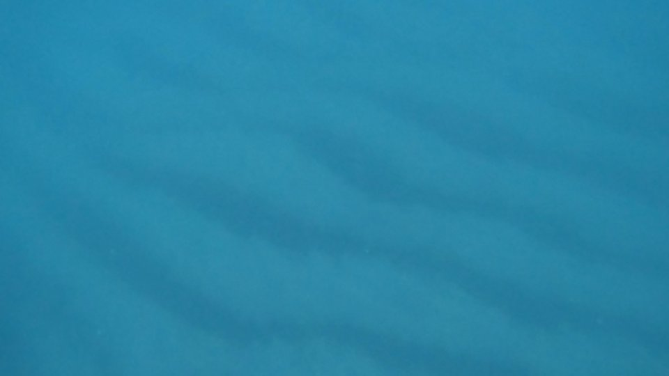

> The pipe is not visible in this frame; the seabed appears as a uniform sandy surface with no discernible pipeline, collar, joint, or signs of marine growth or debris. The yellow outline from the pipe-detection model is not present, so no confirmation of its location can be made from this image alone.

## E002: collar or joint, 4.6 s

**plain**

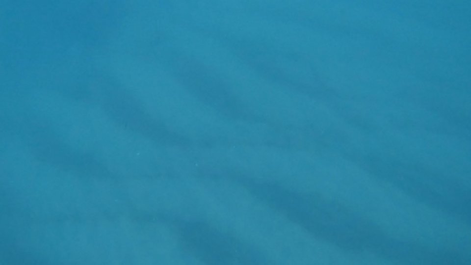

> The pipeline is not visible in this frame; only the seabed surface with gentle sediment ripples is discernible. No collar, joint, marine growth, debris, or damage can be identified due to the lack of clear pipe features or resolution.

**outlined**

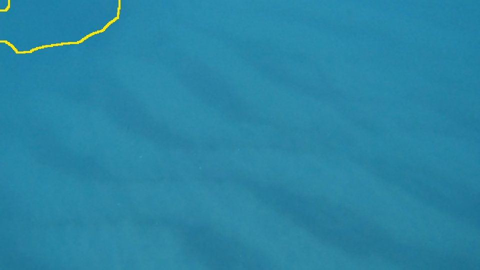

> The pipe is not clearly visible and appears to be obscured by sediment or seabed cover. The yellow outline likely indicates a detected feature, but due to low visibility and possible sediment masking, it is not possible to confirm if this is a collar, joint, or actual pipe. No marine growth, debris, or damage is discernible in this frame.

## E003: pipe not visible, 10.0 s

**plain**

> The pipeline is not visible in this frame; the seabed appears to be covered in sand or sediment, obscuring any clear view of the pipe or its joints. No marine growth, debris, or damage can be confirmed due to the lack of visual clarity.

**outlined**

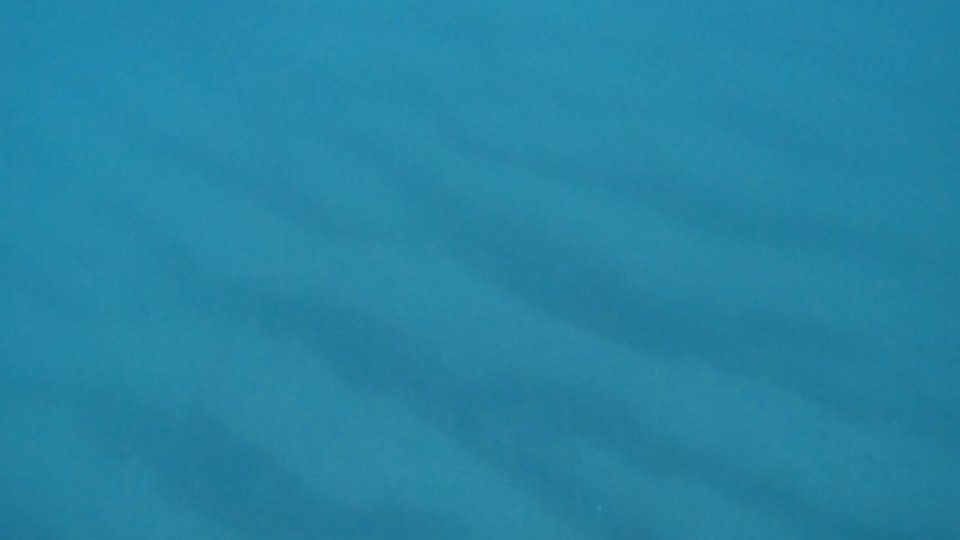

> The pipe is not visible in this frame; the seabed appears as a uniform, sandy substrate with no discernible pipeline, collar, joint, or marine growth. The yellow outline from the detection model is not present, so no confirmation of its location can be made from this image alone.

## E005: pipe not visible, 14.2 s

**plain**

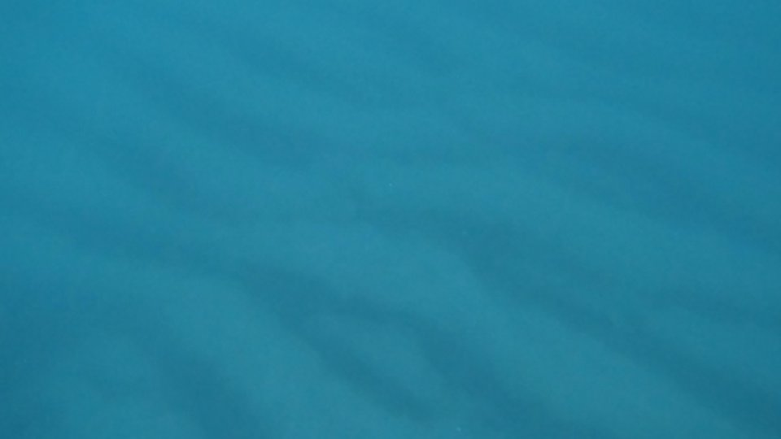

> The pipeline is not visible in this frame; the seabed appears to be covered in sand with no discernible pipe, collar, joint, or marine growth present. The image is too obscured to confirm the pipe’s condition or location.

**outlined**

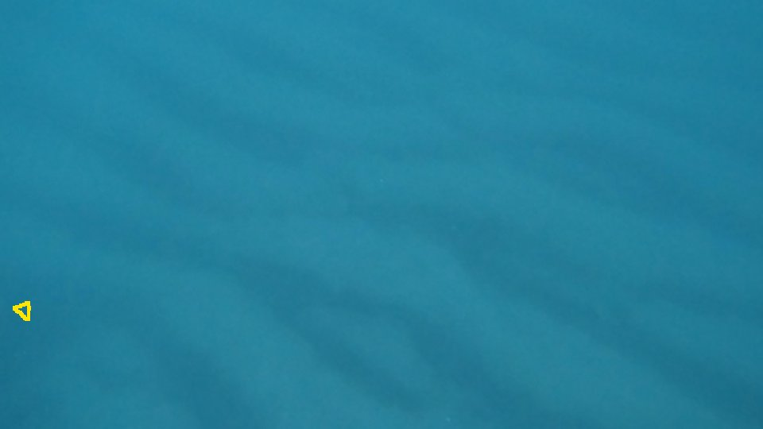

> The pipe is not visible in this frame; the seabed appears as a uniform sandy or silty substrate with no discernible pipeline features. The yellow outline may indicate a false positive, as no physical pipe, collar, joint, or marine growth can be confirmed in the imagery.

## E007: pipe not visible, 20.0 s

**plain**

> The pipeline is not visible in this frame; the seabed appears to be covered in sand or sediment, obscuring any clear view of the pipe or its joints. No marine growth, debris, or damage can be confirmed due to low visibility.

**outlined**

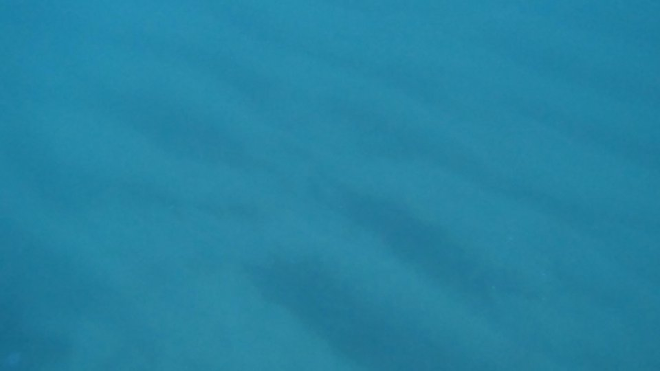

> The pipe is not visible in this frame; the seabed appears as a uniform, sandy substrate with no discernible pipeline, collar, joint, or marine growth. The yellow outline from the detection model is not visible in this frame, so its presence or accuracy cannot be confirmed visually.

## E009: pipe not visible, 26.9 s

**plain**

> The pipeline is not visible in this frame; the seabed appears to be covered in sediment with no discernible pipe, collar, joint, or marine growth. The image is too obscured to confirm the pipe’s condition or location.

**outlined**

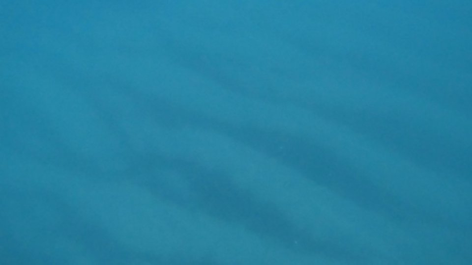

> The pipe is not visible in this frame; the seabed appears as a uniform, sandy substrate with no discernible pipeline, collar, joint, or marine growth. The yellow outline from the detection model is not present, so no confirmation of its location can be made from this image alone.

## E011: pipe not visible, 32.4 s

**plain**

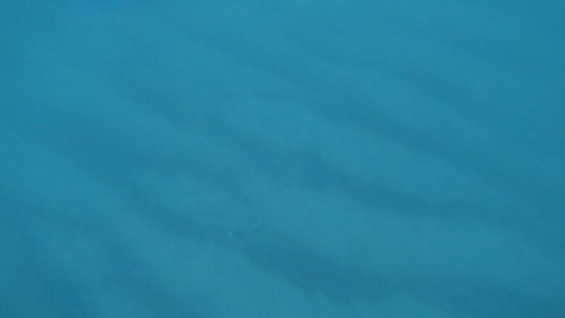

> The pipeline is not visible in this frame; the seabed appears to be covered in sediment with no discernible pipe, collar, joint, or marine growth. The image is too obscured to confirm the pipe’s condition or location.

**outlined**

> The pipe is not visible in this frame; the seabed appears as a uniform, sandy substrate with no discernible pipeline, collar, joint, or marine growth. The yellow outline from the detection model is not visible in this frame, so it cannot be confirmed or used as a reference.

## E013: pipe not visible, 38.2 s

**plain**

> The pipeline is not visible in this frame; the seabed appears to be covered in sediment with no discernible pipe, collar, joint, or marine growth. The image is too obscured to confirm the pipe’s condition or position.

**outlined**

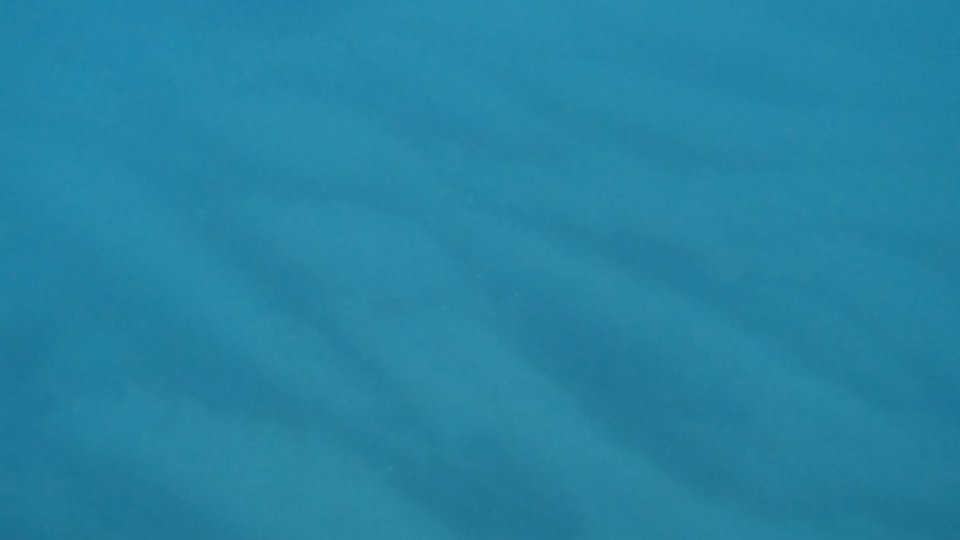

> The pipe is not visible in this frame; the seabed appears as a uniform, sandy substrate with no discernible pipeline, collar, joint, or marine growth. The yellow outline from the detection model is not present, so no confirmation of its location can be made from this image alone.

## E018: collar or joint, 65.1 s

**plain**

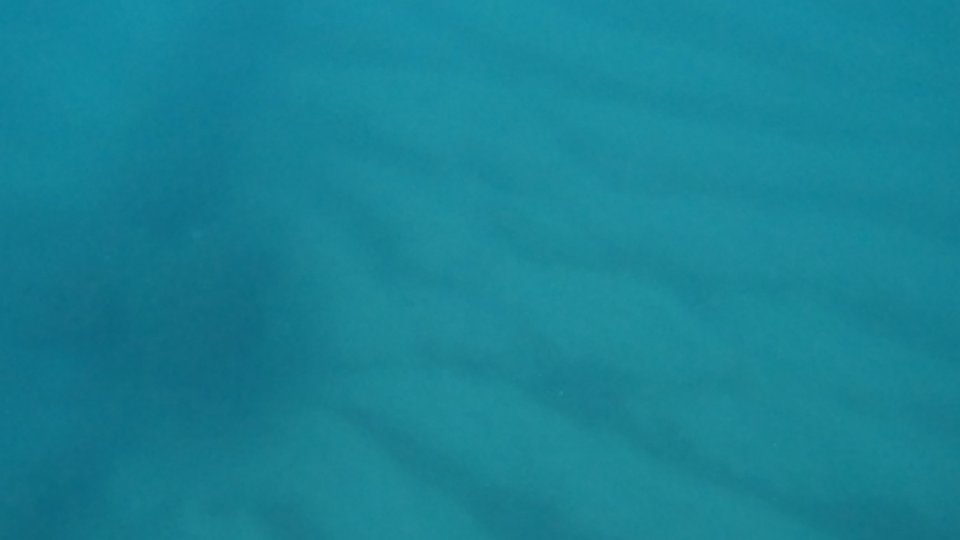

> The pipeline is not clearly visible in this frame; it appears to be buried or obscured beneath a layer of sand. No marine growth, debris, or damage is discernible. No collar or joint can be identified due to insufficient resolution and obscured view.

**outlined**

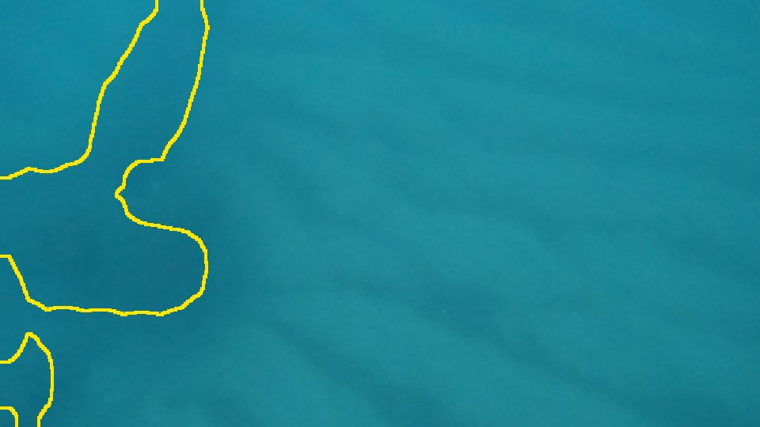

> The pipe is not clearly visible and appears to be obscured by sediment or seabed cover. The yellow outline likely indicates a detected feature, but without clear visual confirmation, it is not possible to confirm if this is a collar, joint, or simply an artifact. No marine growth, debris, or damage is discernible in this frame.

## E029: collar or joint, 135.2 s

**plain**

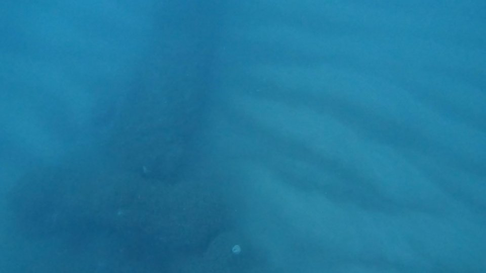

> The pipeline is not clearly visible in this frame; it appears as a faint, indistinct shadow or depression in the seabed sediment. No collar or joint can be definitively identified due to low visibility and sediment obscuring the feature. The seabed is sandy with some suspended particulate matter, but no marine growth, debris, or damage is discernible.

**outlined**

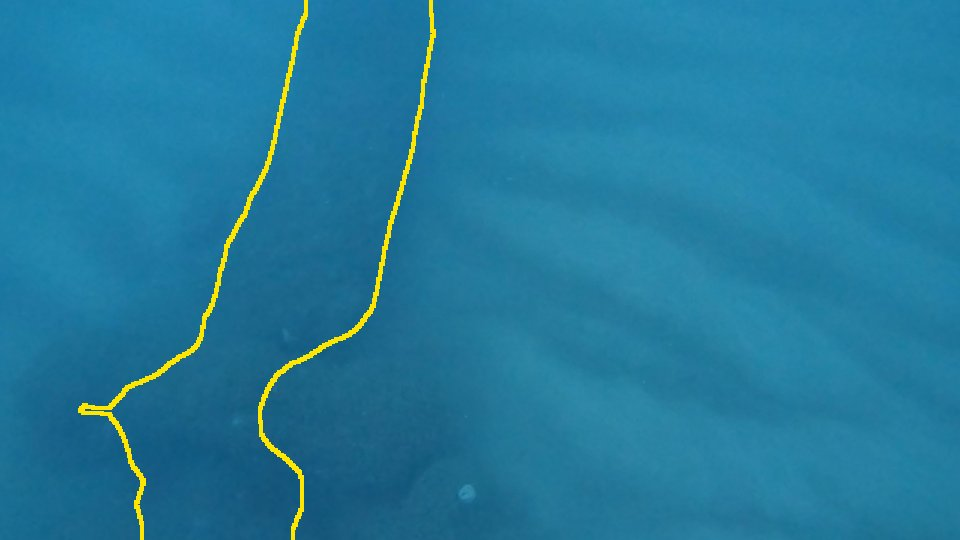

> The pipe is not clearly visible and appears to be buried under sand, with the yellow outline likely indicating a false positive or incomplete detection. No marine growth, debris, or damage is discernible in this frame. No collar or joint can be confirmed due to the poor visibility and potential misalignment of the detection outline.

## E039: collar or joint, 199.2 s

**plain**

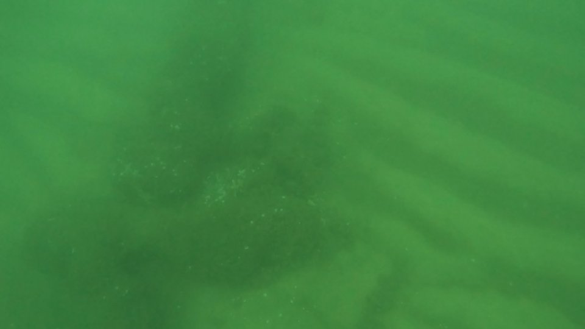

> The pipeline is not clearly visible in this frame; it appears obscured by sediment and low visibility. No distinct collar or joint can be identified due to the turbid water and lack of resolution. The seabed shows some sediment movement and possible organic debris, but no definitive signs of marine growth, damage, or pipeline features are discernible.

**outlined**

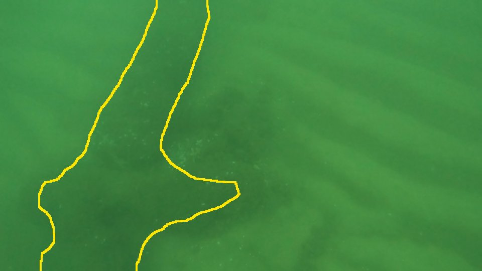

> The pipe is not clearly visible and appears to be obscured by sediment or seabed cover. The yellow outline likely indicates a detected feature, but due to low visibility and turbid water, it is not possible to confirm if this is a collar, joint, or simply an artifact of the detection algorithm. No marine growth, debris, or damage is discernible.

## E050: collar or joint, 262.3 s

**plain**

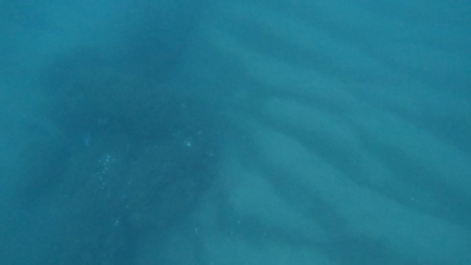

> The pipeline is not clearly visible in this frame; it appears obscured by turbid water and sediment. No distinct collar or joint can be identified, and the seabed is covered in sand with no visible marine growth or debris.

**outlined**

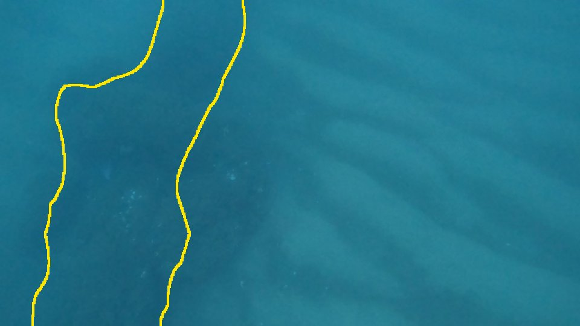

> The yellow outline indicates the system’s detection of a pipeline, but the pipe itself is not clearly visible beneath the sediment or water clarity. The seabed appears to be covered in sand or silt, obscuring any definitive view of the pipe’s surface, joints, or collars. No marine growth, debris, or damage is discernible in this frame.

## E061: collar or joint, 327.2 s

**plain**

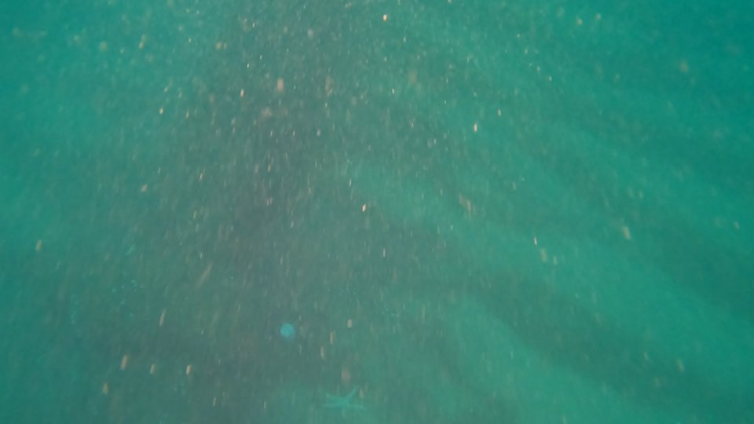

> The pipeline is not clearly visible due to high turbidity and suspended sediment. No distinct collar or joint can be identified; the seabed appears to be covered in sand with minimal marine growth or debris visible.

**outlined**

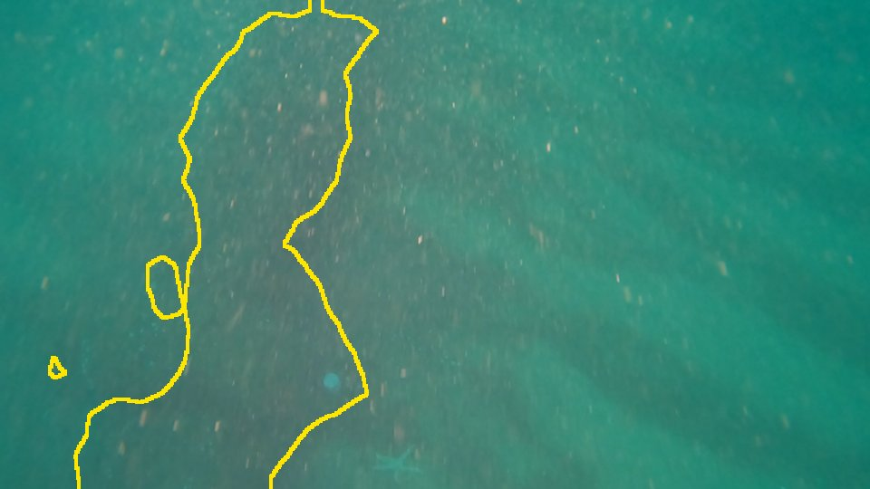

> The pipe is not clearly visible and appears to be obscured by sediment or turbidity. The yellow outline likely indicates a detected feature, but it is not definitive due to poor visibility; no marine growth, debris, or damage can be confirmed. No collar or joint is discernible within the outlined area.

## E072: collar or joint, 387.1 s

**plain**

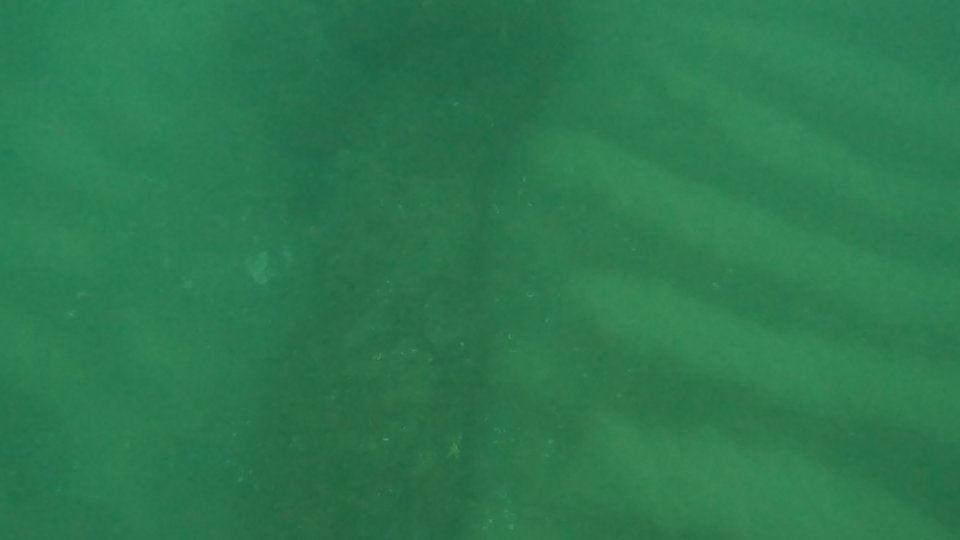

> The pipeline is not clearly visible due to turbid water and sediment obscuring the seabed. No distinct collar or joint can be identified; the image is too blurry to determine if the pipe is exposed, covered, or in good condition.

**outlined**

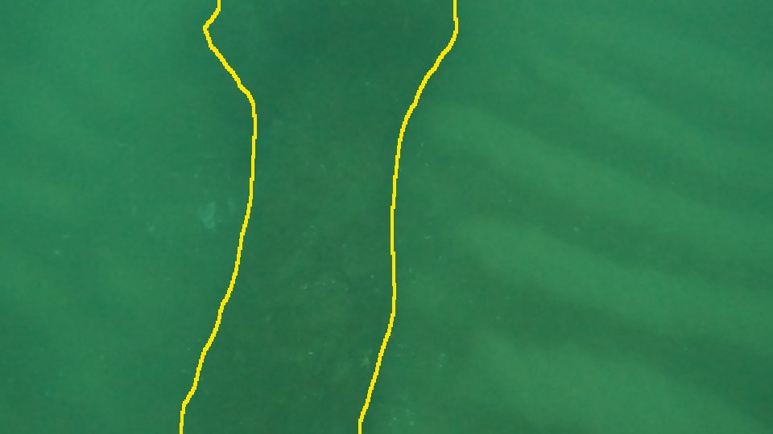

> The pipe is not clearly visible and appears to be buried or covered by sediment, making it difficult to confirm its condition or presence. The yellow outline likely indicates a detected pipe, but due to the obscured view, no definitive marine growth, debris, or damage can be assessed. No collar or joint is clearly identifiable in this frame.

## E078: pipe not visible, 416.8 s

**plain**

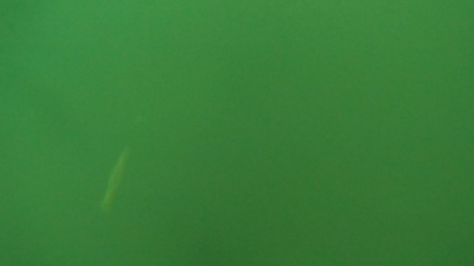

> The pipeline is not visible in this frame due to high turbidity and poor visibility. No collar, joint, marine growth, debris, or exposure of the pipe can be confirmed from this image.

**outlined**

> The pipe is not clearly visible in this frame; the water is very turbid and green, obscuring details. There is no discernible marine growth, debris, or damage, and no collar or joint can be confirmed. The yellow outline from the detection model may be incorrect, as no distinct pipe feature is visible to verify its presence.

## E085: collar or joint, 453.4 s

**plain**

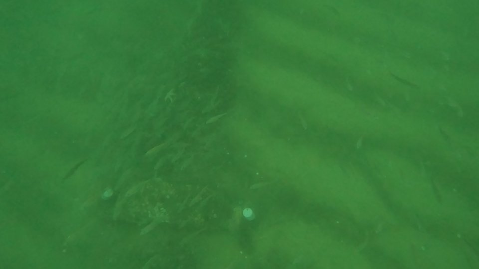

> The pipeline is not clearly visible due to turbid water and sediment obscuring the seabed. No distinct collar or joint can be identified; the feature flagged by the system is likely an artifact of the imaging or a buried section of pipe. No marine growth, debris, or damage is discernible.

**outlined**

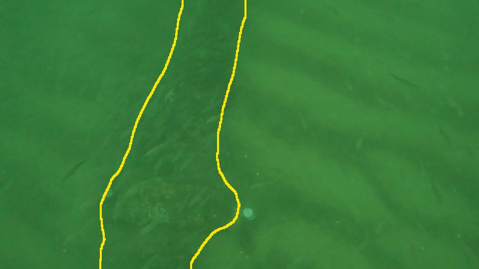

> The yellow outline indicates the system’s detection of a pipeline, but the pipe itself is not clearly visible beneath the turbid water. The seabed appears sandy and disturbed, with no discernible pipe, collar, or joint. The outline may be incorrect or misaligned, as no structural features matching a pipeline or its components can be confirmed in this frame.

## E089: pipe not visible, 473.5 s

**plain**

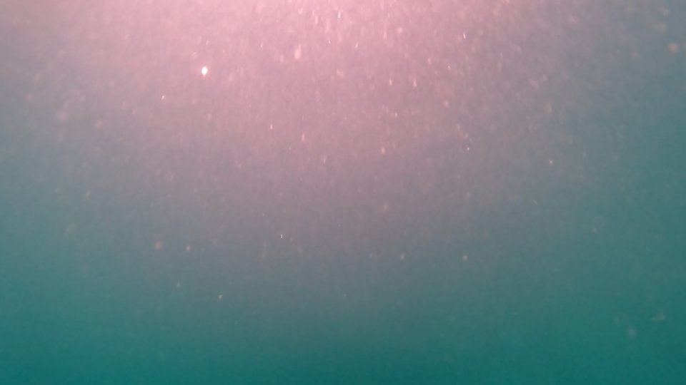

> The pipeline is not visible in this frame. The seabed appears to be covered in sediment, and the water column is turbid with suspended particles, obscuring any clear view of the pipeline or its features.

**outlined**

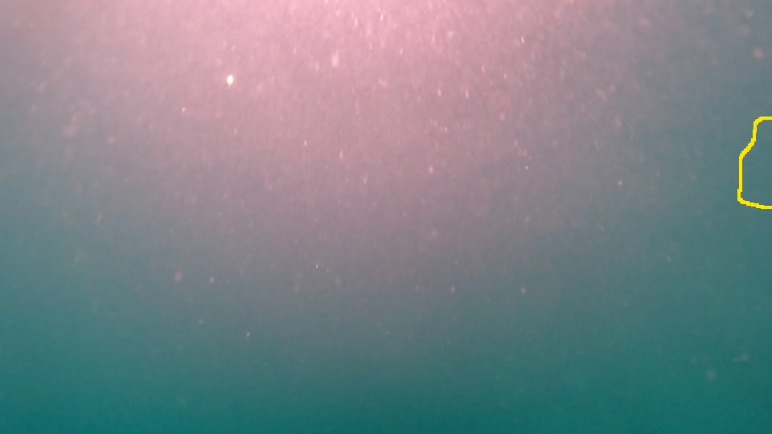

> The pipe is not clearly visible in this frame; the yellow outline provided by the detection model may be incorrect or incomplete. The seabed appears sandy and murky, with no discernible pipeline, joints, collars, marine growth, or debris visible within the outlined area or surrounding it.

## E092: pipe not visible, 483.9 s

**plain**

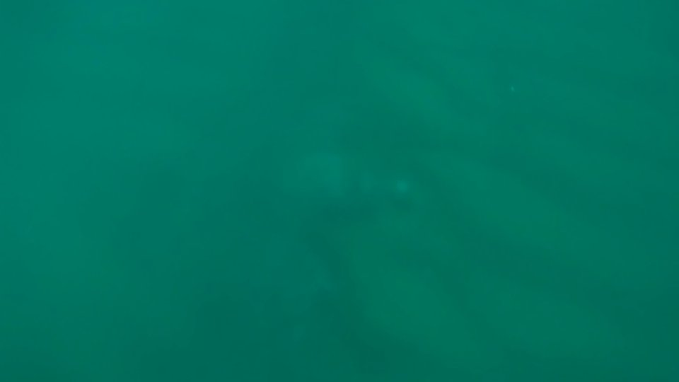

> The pipeline is not visible in this frame due to turbid water conditions. No marine growth, debris, damage, collars, or joints can be discerned.

**outlined**

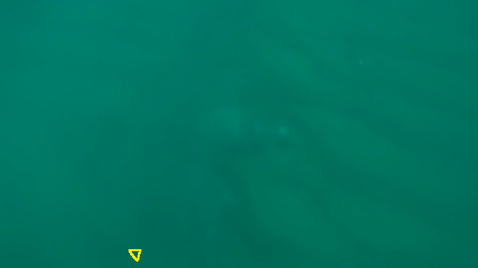

> The pipe is not clearly visible in this frame; the seabed is obscured by turbid water, making it difficult to confirm its presence or condition. The yellow outline indicates the system’s detection, but due to low visibility, no definitive confirmation of the pipe’s location, exposure, or integrity can be made.

## E100: collar or joint, 535.7 s

**plain**

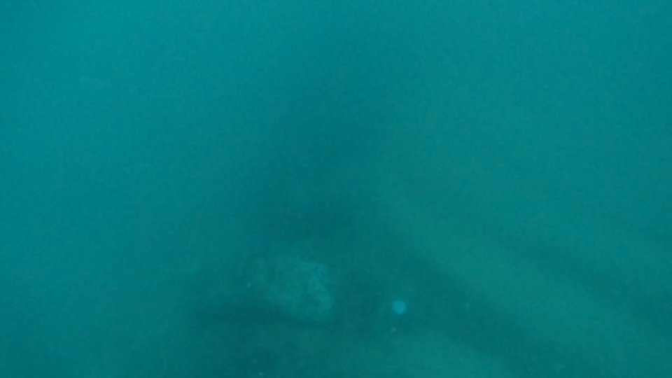

> The pipeline is not clearly visible in this frame due to turbid water conditions. No distinct collar or joint can be identified, and the seabed appears to be covered in sediment with no discernible marine growth or debris.

**outlined**

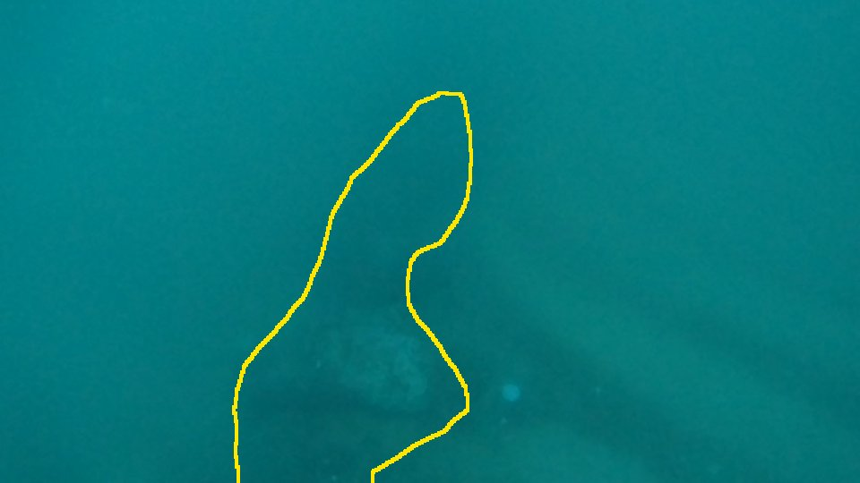

> The yellow outline indicates a potential pipe collar or joint, but the feature is obscured by sediment and low visibility, making it difficult to confirm if it is a pipe, joint, or debris. No clear marine growth, damage, or exposed pipe is visible within the outlined area.

## E101: pipe not visible, 536.4 s

**plain**

> The pipeline is not visible in this frame; the seabed appears uniformly covered in sediment with no discernible pipe, collar, joint, or marine growth. The image is too obscured to confirm the pipe’s condition or position.

**outlined**

> The pipe is not visible in this frame; the seabed appears uniformly covered in sediment with no discernible pipeline, collar, joint, or marine growth. The yellow outline from the detection model is not visible in this frame, so its presence or accuracy cannot be confirmed visually.
